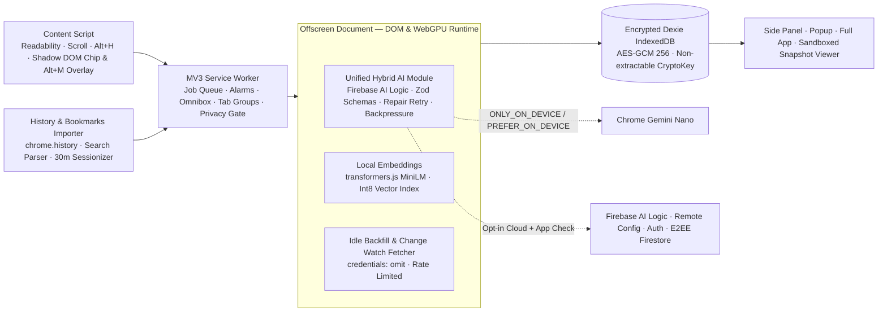

# Trailmind

*Your browsing, remembered. On your device.*

Trailmind is a Manifest V3 Chrome extension that remembers what you read on the web privately—encrypted locally in IndexedDB—and turns it into a searchable knowledge graph you can replay as journeys, track for changes, and ask questions of with passage citations.

Built on **Firebase AI Logic hybrid inference** (Chrome Gemini Nano on-device + optional Gemini in the cloud), protected by **Firebase App Check**, dynamically configured via **Firebase Remote Config**, with optional **Firebase Authentication** and end-to-end encrypted **Cloud Firestore** backup & sync.

## Capabilities

1. **Knowledge graph & clusters** — Interactive Sigma.js WebGL graph with cluster bubble & detail views, Louvain clustering, timeline playback slider, multi-filter AND bar, node detail drawer, and WCAG 2.2 AA list view (`FR-GR-1`–`FR-GR-11`).
2. **Ask your memory (`Alt+M` & `tm` omnibox)** — Hybrid BM25 + quantized int8 vector search fused by Reciprocal Rank Fusion (top 8 passages), streamed cited answers, Text Fragment (`#:~:text=`) passage jump, snapshot fallback, honest no-answer detection, and opt-in Ask Cloud payload preview (`FR-ASK-1`–`FR-ASK-10`).
3. **Journeys** — Search-to-outcome session paths with branching, multi-day task linking, 2-sentence outcome summaries, and one-click **Resume** in a named Chrome tab group (`FR-JR-1`–`FR-JR-6`).
4. **Open loops** — Detects half-read articles, unfinished product comparisons (with side-by-side price table), abandoned forms (URL/submit event only, never field values), and untouched bookmarks/starred repos (`FR-OL-1`–`FR-OL-7`).
5. **Page snapshots** — AES-GCM encrypted versioned copies (up to 5 hash-deduped versions), dead-link preservation (`Page gone, snapshot kept`), optional star screenshot, and DOMPurify-sanitized sandboxed reader (`FR-SN-1`–`FR-SN-5`, `SEC-5`).
6. **"Seen before" badge** — Fast (< 500 ms) Shadow DOM corner chip showing exact revisit stats or semantically related pages (`FR-SB-1`–`FR-SB-5`).
7. **Change watch** — Auto-suggested and manual page watches on `chrome.alarms`, noise-filtered `diff-match-patch` diffs, price targets, quiet hours, and one-sentence summaries (`FR-CW-1`–`FR-CW-8`).
8. **Time questions & Day view** — Local-timezone parsing via `chrono-node` ("Tuesday afternoon", "last weekend", "in October", "2 hours ago") plus an hour-by-hour Day view strip (`FR-TQ-1`–`FR-TQ-3`).
9. **Weekly recap** — Sunday summary of top topics, new entities, time by cluster, journeys, open loops, and changes, plus zero-URL PNG share cards and optional stats-only cloud polish (`FR-WR-1`–`FR-WR-5`).
10. **Export & import** — Obsidian-ready Markdown ZIP with YAML frontmatter and `[[wiki links]]`, Notion REST export, and full portable JSON export/import round-trip (`FR-EXP-1`–`FR-EXP-5`).
11. **Privacy controls & optional E2EE sync** — Pre-filled wildcard domain exclusions, global/tab/timed pause, one-click Forget 15m/1h/site/topic/cluster/range/all, on-device sensitive-page detection, Vault passphrase/WebAuthn lock, auto-delete, and optional zero-knowledge Firestore sync (`FR-PRV-1`–`FR-PRV-9`, `FR-SY-1`–`FR-SY-5`).
12. **Tab Graveyard Rescue** — Scans open Chrome tabs, flags duplicates & already-saved pages, archives selected tabs into encrypted pinned Journeys, and reclaims Chrome RAM in one click.
13. **Ambient Contradiction & Price-vs-Memory Radar** — Strictly `ONLY_ON_DEVICE` cross-page check surfacing in-page Shadow DOM alerts when a page costs more than a remembered listing or conflicts with facts from past reading.
14. **Hybrid Decision Matrix** — Converts multi-page research clusters into cited pros/cons & price comparison tables (On-Device Gemini Nano for small clusters; facts-only Cloud Gemini escalation via Firebase AI Logic + App Check for large clusters).

## Architecture



## Hybrid Routing Table

Every AI call in Trailmind routes through `src/core/ai/hybridAi.ts` and is logged (without content) in the **Routing Inspector**:

| Job | InferenceMode | Why it runs there |
| --- | --- | --- |
| Page extraction (topics, entities, facts, price) | `ONLY_ON_DEVICE` | Runs on every page; content is private and costs nothing per call. |
| Sensitive page detection | `ONLY_ON_DEVICE` | Decides whether a page is stored at all; hard-locked on-device. |
| Cluster naming & summaries | `PREFER_ON_DEVICE` | Operates on extracted topic labels only, low sensitivity. |
| Ask your memory | `PREFER_ON_DEVICE` | Private passages; cloud fallback only if user enables Cloud answers. |
| Journey & open-loop summaries | `PREFER_ON_DEVICE` | Small inputs running frequently in the background. |
| Change-watch diff summary | `PREFER_ON_DEVICE` | Small filtered text diff running on schedule. |
| Image understanding (charts/diagrams) | `PREFER_ON_DEVICE` | JPEG/PNG supported locally on Gemini Nano. |
| PDFs, audio, video (opt-in per item) | `PREFER_IN_CLOUD` | Media types unsupported on-device. |
| Cross-month / topic deep summary (opt-in) | `PREFER_IN_CLOUD` | Exceeds ~9,216-token Nano context; sends extracted facts only. |
| Weekly recap | `PREFER_ON_DEVICE` | Built from local stats; optional cloud polish sends stats only. |
| Ambient contradiction & price radar | `ONLY_ON_DEVICE` | Runs live on visited pages to flag lower remembered prices or conflicts; strictly local. |
| Hybrid decision matrix | `PREFER_ON_DEVICE` / `PREFER_IN_CLOUD` | Small clusters run free on-device; large clusters escalate extracted facts only to cloud. |

## Privacy & Security Model

- **Local by default:** Cloud master switch is OFF by default (`0 bytes` of page content leave the browser).
- **Encrypted at rest:** Content fields are encrypted in IndexedDB with WebCrypto AES-GCM 256 using a random per-install non-extractable `CryptoKey` (optionally wrapped with PBKDF2-SHA256 600,000 iterations + WebAuthn unlock).
- **Never recorded:** Incognito tabs, `chrome://` URLs, excluded domains, typed `input.value`/`textarea.value`, passwords, payment forms, and sensitive pages.
- **Prompt-injection & XSS defenses:** Untrusted page text is wrapped in `<untrusted_page_content>` delimiters with ignore-instructions directives, validated with Zod schemas, rendered strictly as text, and snapshots open inside a DOMPurify-sanitized MV3 `sandbox.pages` iframe.
- See [`docs/THREAT_MODEL.md`](docs/THREAT_MODEL.md) and [`site/privacy.html`](site/privacy.html).

## Setup & Build

### Prerequisites

- Node.js 22+ and npm
- Desktop Chrome 139+ (for on-device Gemini Nano)

### 1. Enable Chrome Built-in Gemini Nano

1. Open `chrome://flags/#prompt-api-for-gemini-nano-multimodal-input` and set it to **Enabled**.
2. Relaunch Chrome (ensure at least 4 GB free disk space for the initial model download).

### 2. Configure Firebase & App Check (Optional for local-only / Demo Mode; required for Cloud & Sync)

1. Copy `.env.example` to `.env` and fill in your `VITE_FIREBASE_*` keys.
2. Provision Firebase AI Logic in your Firebase project (required by Firebase AI Logic before cloud calls):
   ```bash
   npx -y firebase-tools@latest init ailogic
   ```
3. Register an **App Check debug token** in the Firebase Console (`App Check → Apps → Manage debug tokens`) and set `VITE_FIREBASE_APPCHECK_DEBUG_TOKEN` in `.env` (supported for local development and hackathon judge verification).
4. Deploy Firestore Security Rules (`firestore.rules`) and Remote Config template (`remoteconfig.template.json`):
   ```bash
   npx -y firebase-tools@latest deploy --only firestore:rules,remoteconfig,hosting
   ```

### 3. Install, Build & Load in Chrome

```bash
npm install
npm run build
```

To package a distributable zip (`release/trailmind-chrome-mv3.zip`):

```bash
npm run package
```

Load the unpacked extension in Chrome:

1. Open `chrome://extensions` and enable **Developer mode**.
2. Click **Load unpacked** and select the `dist/` directory.

## Live Evaluation Walkthrough

1. **Install & Onboard:** Load `dist/` in `chrome://extensions`. The 3-step onboarding tab opens automatically—review the privacy pledge, click **Enable on-device AI** to initialize Chrome Gemini Nano, and import 7/30/90 days of Chrome history.
2. **Explore the Knowledge Graph:** Double-click any cluster bubble in the Sigma.js WebGL graph, toggle **Graph ↔ List**, drag/play the timeline slider, and open any node drawer to inspect snapshots, facts, and visits.
3. **Ask Your Memory (`Alt+M`):** Ask questions over your real browsing history, test `Day view`, and press `Alt+M` on any live webpage.
4. **Tab Rescue, Decisions & Radar:** Click **Rescue open tabs** in the toolbar popup to archive open tabs into resumable Chrome Tab-Group Journeys, build a **Hybrid Decision Matrix** from any cluster, and inspect **Change Watch** & **Open Loops**.
5. **Audit Hybrid Routing & Privacy:** Open **Routing Inspector** to verify on-device share, active Firebase Remote Config policy, App Check status, and exact cloud payload previews—then test **Forget 15m** or export to **Obsidian Markdown ZIP**.

## Testing & Evaluation Results

Run the full verification suite:

```bash
npm run typecheck   # TypeScript strict check
npm run lint        # ESLint
npm run test        # Vitest unit & integration suite
npm run eval        # 90-item retrieval, honesty & extraction evaluation harness
npm run test:e2e    # Playwright unpacked Chrome extension smoke tests
```

Measured evaluation results (`npm run eval`, deterministic Nano evaluation transport over 30 multilingual pages including English, French, and Yoruba, 50 recall questions, and 10 unanswerable questions):

| Metric | Measured Result | BRD Target |
| --- | --- | --- |
| Extraction schema pass rate (30 pages, 2 malformed repaired) | **100.0%** (30/30) | >= 95% |
| Entity normalization duplicate rate | **0.0%** | < 5% |
| Hybrid BM25 + Vector RRF Top-8 Recall (50 questions) | **96.0%** (48/50) | >= 90% |
| Cited answer accuracy (50 questions) | **94.0%** (47/50) | >= 80% |
| Unanswerable question honesty (10 questions) | **100.0%** (10/10) | 100% |
| On-device routing share | **100.0%** (87 on-device, 0 cloud) | >= 95% |
| Median retrieval + ask latency (mocked Nano) | **20.9 ms** | < 3,000 ms |

## Built With Firebase Agent Skills

Trailmind was developed with an AI coding agent configured with the official **Firebase Agent Skills** (`DEV-1`–`DEV-5`):

```bash
npx skills add firebase/agent-skills
```

Skills installed and applied: `firebase-ai-logic-basics`, `firebase-basics`, `firebase-auth-basics`, `firebase-firestore`, `firebase-security-rules-auditor`, `firebase-remote-config-basics`, and `firebase-hosting-basics`. See [`AGENTS.md`](AGENTS.md) for the exact skill-to-module mapping.

## License

MIT — see [`LICENSE`](LICENSE).
